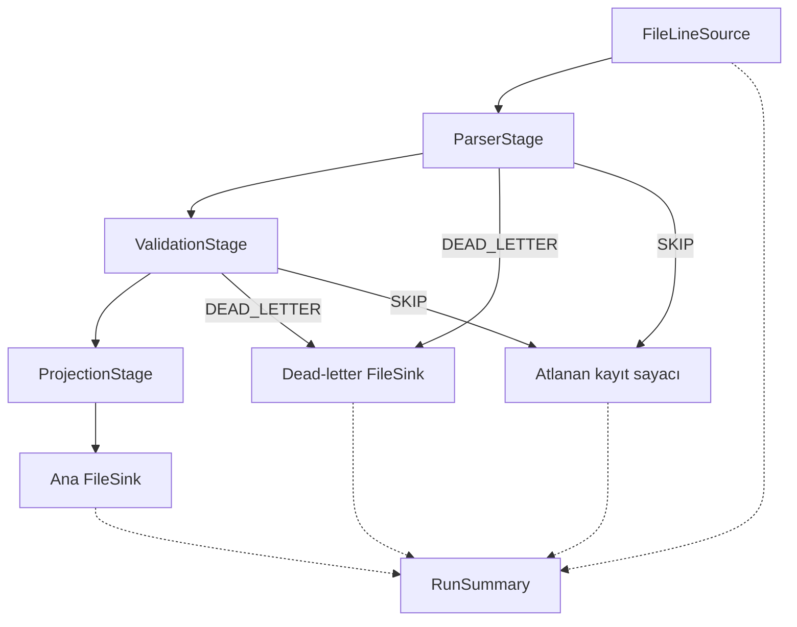

# LogFlow — Mimari Dokümantasyon

**Proje:** LogFlow — Yazılım Mimarisi Dönem Projesi  
**Teknoloji:** Java, JUnit 5, SnakeYAML 2.7  
**Kapsam:** Artım 1, Artım 2, Artım 3 ve Artım 4

> Bu belge, paylaşılan uygulama kodları ve test sonuçları ile öğretim elemanının dört artım yönergelerine dayanır. Tamamlanmış özellikler ile teslim öncesi düzeltilmesi gereken noktalar ayrı belirtilmiştir.

## 1. Projenin Amacı ve Mimari Yaklaşım

LogFlow, günlük (log) dosyalarını ardışık ve bağımsız bileşenler aracılığıyla işleyen Java uygulamasıdır. Mimari, **Source → Stage → Sink** veri akışına dayanır. Kaynak veriyi üretir, aşamalar veriyi dönüştürür veya eler, hedef bileşen sonuçları tüketir. `Pipeline`, bileşenleri bağlayıp çalıştırır.

```text
                      Pipeline
                         |
                         v
 FileLineSource --> ParserStage --> PredicateFilterStage --> ProjectionStage --> FileSink
      |                |                  |                       |              |
  String satır       LogRecord         0 veya 1 kayıt          Seçili alanlar   Dosya
```

Aşamalar `Emitter` üzerinden veri iletir. Bu yaklaşım, bir girdiden sıfır, bir veya birden fazla çıktı üretmeye imkân tanır. Bileşenlerin sorumluluklarını ayırmak, bağımsız test etmeyi ve aşamaları yeniden kullanmayı kolaylaştırır.

## 2. Artım 1 — İskelet Pipeline

### 2.1. Mimari hedef

İlk artımın odağı **bileşenler ve bağlayıcılar** ile **arayüz ve uygulama ayrımıdır**. İlk çalışan sistemin amacı, bir metin dosyasını `Main` içinde satır satır işlemeye çalışmadan pipeline aracılığıyla okumak ve konsola yazdırmaktır.

### 2.2. Temel sözleşmeler

```java
public interface Emitter<T> {
    void emit(T item);
}

public interface Source<O> {
    void produce(Emitter<O> out);
}

public interface Stage<I, O> {
    void process(I input, Emitter<O> out) throws StageException;
    default void open() {}
    default void close() {}
}

public interface Sink<I> {
    void consume(I item);
}
```

`Stage<I,O>` girdiyi işleyip `Emitter<O>` aracılığıyla aktarır. `Source` veri üretir; `Sink` veriyi tüketir. Sonraki artımlarda `Sink` sözleşmesine kaynak yönetimi için `open()` ve `close()` kancaları eklenmiştir.

### 2.3. İlk mimari akış

```text
+----------------+         +----------------+
| FileLineSource | ------> |  ConsoleSink   |
+----------------+         +----------------+
       Kaynak                  Hedef
       \__________ Pipeline.run() _________/
```

- `FileLineSource`: `data/access-small.log` dosyasını satır satır okur.
- `ConsoleSink`: gelen satırları konsola yazar.
- `Pipeline`: kaynak ile hedef arasındaki akışı kurar.
- `Main`: argümanları alır, pipeline'ı kurar ve `run()` çağırır.

**Yönergedeki teslimler:** Temel arayüzler, kaynak/hedef uygulamaları, `Pipeline`, `Main`, örnek veri dosyası, README, iki kutulu mimari diyagram ve `v1` etiketi. Bu belgedeki anlatım ilk artımın tasarımını gösterir; mevcut `Main` daha sonraki artımlarda genişletilmiştir.

## 3. Artım 2 — Tipli Kayıtlar ve Ayrıştırma

### 3.1. Mimari hedef

Ham `String` satırlarından alan modeli olan `LogRecord` nesnelerine geçiş; **sorumlulukların ayrılması**, **veri soyutlama** ve **birim testi disiplini**.

### 3.2. LogRecord

```java
public record LogRecord(
    Instant timestamp,
    String clientIp,
    String method,
    String path,
    int status,
    long bytes,
    String userAgent,
    Map<String, String> attributes,
    String raw
) {}
```

Java `record`, alanlara yeniden değer atanmasını engeller. Bununla birlikte `attributes` alanına değiştirilebilir bir `Map` verilirse içerik değişebilir; **derin değişmezlik** için savunmacı kopyalama (`Map.copyOf`) gerekir. `attributes`, ileriki artımlarda ek bilgiler taşımak üzere bir genişleme noktasıdır.

### 3.3. ParserStage ve hata politikası

`ParserStage`, Common Log Format (CLF) satırını `LogRecord` nesnesine dönüştürür. Hatalı satırları bu artımda **atlar ve sayar**; hata sayısı `getErrorCount()` üzerinden okunur. Ayrıntılı çalışma zamanı hata yönetimi sonraki artımın konusudur.

```text
FileLineSource (String)
       |
       v
ParserStage (CLF -> LogRecord; geçersiz satırları sayar)
       |
       v
ConsoleSink (okunabilir tek satır)
```

### 3.4. Test yaklaşımı

`CollectingEmitter`, aşamanın ürettiği kayıtları bellekte toplar; bu sayede `ParserStage` testleri dosya sistemine erişmeden çalıştırılabilir. Yönerge en az sekiz ayrıştırıcı senaryosu ister: geçerli satır, eksik alan, hatalı zaman damgası, hatalı durum kodu, boş satır, fazla boşluk, boşluk içeren tırnaklı user-agent ve sorgu dizeli yol.

Önceki çalışmada JaCoCo **satır kapsama oranı %76,24** olarak raporlanmıştır; bu değer Artım 2 çalışmasına aittir, Artım 4 için yeniden ölçülmüş bir oran değildir.

**Yönergedeki teslimler:** `LogRecord`, `ParserStage`, JUnit 5 testleri, kapsama oranının README'de raporlanması, CHANGELOG kaydı ve `v2` etiketi.

## 4. Artım 3 — Bileşim, Filtreleme ve Projeksiyon

### 4.1. Mimari hedef

Modülerlik, bileşilebilirlik ve aşama düzeyinde tek sorumluluk. İşlem hattı, birbirinden bağımsız aşamaların farklı sıralarda bir araya getirilmesiyle kurulur.

### 4.2. Yeni bileşenler

| Bileşen | Sorumluluk | Girdi → Çıktı |
|---|---|---|
| `PredicateFilterStage` | `Predicate<LogRecord>` koşuluna göre kayıtları iletmek veya elemek | `LogRecord` → `LogRecord` |
| `ProjectionStage` | Yalnızca seçilen alanları aktarmak | `LogRecord` → `Map<String,Object>` |
| `FileSink` | Sonuçları dosyaya yazmak ve dosya kaynağını kapatmak | Kayıt → Dosya |
| `PipelineBuilder` | Akıcı API ile aşamaları bağlamak | Pipeline tanımı → `Pipeline` |

Filtre örnekleri: `status >= 400`, `path.startsWith("/api")`, belirli zaman aralığı. Projeksiyon seçilen alanları `LinkedHashMap` içinde belirtilen sırada tutar; çıktı boyutunu azaltma ve veri minimizasyonu açısından faydalıdır.

`FileSink` için `open()` yazıcıyı açar, `consume()` kayıt yazar, `close()` yazıcıyı kapatır. Pipeline yaşam döngüsünün bu çağrıları doğru sırada yapması, tamponlanan verinin kaybolmaması açısından önemlidir.

### 4.3. Fluent PipelineBuilder

```java
Pipeline pipeline = PipelineBuilder
    .from(new FileLineSource(inputFile))
    .via(new ParserStage())
    .via(new PredicateFilterStage(r -> r.status() >= 400))
    .via(new ProjectionStage("clientIp", "status", "path"))
    .to(new FileSink<>(outputFile));

pipeline.run();
```

`via()` çağrıları aşama zincirini oluşturur. Java jenerikleri zincirleme çağrılarda tür uyumunu denetlemeye yardımcı olur. Ancak yapılandırmadan oluşturulan `List<Stage<?,?>>` üzerinde tür uyumu derleme zamanında bütünüyle garanti edilmez; YAML yükleyicisinde ayrıca doğrulama gerekir.

### 4.4. Komut satırı arayüzü

Desteklenen parametreler: `--min-status`, `--path-prefix`, `--fields`, `--output`.

```powershell
javac -cp "lib/*" -d out src\*.java
java -cp "out;lib/*" Main data/access-small.log --min-status 400 --path-prefix /api --fields clientIp,status,path --output output.log
Get-Content output.log
```

### 4.5. Filtre sıralaması deneyi

**Amaç:** Aynı kayıtlar üzerinde filtre sırası değiştiğinde çıktı eşitliğini ve işlem maliyetini karşılaştırmak.

**Veri:** `data/filter-experiment.log`, 200 CLF kaydı; HTTP 200/500 ve `/api/users`/`/home` yolları.

```text
Sıra A: FileLineSource -> ParserStage -> Status Filter -> Path Filter -> Projection -> Sink
Sıra B: FileLineSource -> ParserStage -> Path Filter -> Status Filter -> Projection -> Sink
```

| Ölçüm | Status → Path | Path → Status |
|---|---:|---:|
| Girdi kaydı | 200 | 200 |
| Çıktı kaydı | 20 | 20 |
| Status kontrolü | 200 | 100 |
| Path kontrolü | 40 | 200 |
| Toplam filtre kontrolü | 240 | 300 |
| Çıktıların eşitliği | Evet | Evet |
| Paylaşılan tek çalıştırmadaki süre | 90,222 ms | 11,791 ms |

**Değerlendirme:** Her iki sıralama da 20 kayıt üretmiştir. Status filtresini önce uygulamak 60 daha az koşul kontrolü yapmıştır (300'e göre %20 azalma). Buna karşılık paylaşılan **tek çalıştırmadaki süre** Path → Status için daha kısa görünmektedir. JVM ısınması, JIT derlemesi, disk önbelleği ve sistem yükü gibi etkenler nedeniyle bu tek ölçümden kesin hız üstünlüğü çıkarılamaz. Sağlam karşılaştırma için ısınma turları, tekrarlı ölçümler ve ortanca süre raporlanmalıdır. Parser'dan önce `LogRecord` alanlarıyla filtreleme yapılamaz; ayrıca mevcut `ProjectionStage` sonrasında `PredicateFilterStage<LogRecord>` doğrudan kullanılamaz çünkü veri türü değişmiştir.

### 4.6. Artım 3 testleri

- `PredicateFilterStageTest`: 7 test.
- `ProjectionStageTest`: 8 test.
- `FileSinkTest`: 7 test.
- `PipelineIntegrationTest`: 1 test; küçük CLF verisinden üretilen dosyanın içeriği doğrulanır.

Artım 3 sonundaki toplu çalıştırmada **32 test başarılı, 0 başarısız** olarak raporlanmıştır. Artım 3 teslimleri arasında `v3` etiketi ve bu deneyin `ARCHITECTURE.md` içinde belgelenmesi bulunur.

## 5. Artım 4 — Yapılandırma Odaklı Birleştirme ve Aşama Kaydı

### 5.1. Mimari hedef

İşlem hattı topolojisini Java kodundan **bildirimsel YAML yapılandırmasına** taşımak. Amaç, aynı derlenmiş uygulamanın yalnızca yapılandırma dosyası değiştirilerek farklı pipeline'lar çalıştırabilmesidir.

### 5.2. Yapılandırma akışı

```text
configs/*.yaml
      |
      v
YamlConfigLoader (SnakeYAML)
      |
      v
PipelineConfigBuilder (YAML doğrulama ve pipeline oluşturma)
      |
      +----> FileLineSource
      +----> ParserStage / PredicateFilterStage / ProjectionStage
      +----> FileSink
      |
      v
Pipeline.run()
```

**Uygulanan registry mimarisi:**

```text
YAML stage.type -> StageRegistry -> StageFactory -> somut Stage
                              ^
                              |
                    DefaultStageRegistry
                    (isim -> fabrika kaydı)
```

`StageFactory` parametrelerden aşama üreten fonksiyonel arayüzdür. `StageRegistry`, isimleri fabrikalarla eşleyen `Map<String, StageFactory>` tutar. `DefaultStageRegistry`, `parser`, `filter`, `projection` kayıtlarını sağlar.

**Tamamlanan entegrasyon:** `PipelineConfigBuilder`, YAML aşama türünü `registry.create(type, params)` ile çözer. Sabit `switch (type)` kaldırılmıştır; aşamalar `DefaultStageRegistry` tarafından kayıtlı fabrikalar üzerinden oluşturulur. Öğretim elemanının `PipelineLoader` olarak adlandırdığı sorumluluk bu projede `PipelineConfigBuilder` tarafından yerine getirilir. İsim farkı korunmuştur.

### 5.3. Mevcut YAML şeması

Paylaşılan uygulama, hocanın örneğindeki `pipeline.name` ve iç içe `params` biçiminden farklı olarak **kök düzeyde** `source`, `stages`, `sink` anahtarlarını ve **doğrudan parametreleri** kullanır:

```yaml
source:
  type: file
  path: data/access-small.log

stages:
  - type: parser
  - type: filter
    minStatus: 400
  - type: projection
    fields:
      - timestamp
      - clientIp
      - status
      - path

sink:
  type: file
  path: error-report.log
```

| Anahtar | Tür | Açıklama |
|---|---|---|
| `source` | nesne | Zorunlu; `type: file`, `path: metin` |
| `stages` | liste | Aşama tanımları; her öğede `type` bulunur |
| `stages[].type` | metin | `parser`, `filter`, `projection` |
| `minStatus` | sayı | `filter` için isteğe bağlı alt durum kodu |
| `pathPrefix` | metin | `filter` için isteğe bağlı URL öneki |
| `fields` | metin listesi | `projection` için zorunlu alanlar |
| `sink` | nesne | Zorunlu; `type: file`, `path: metin` |

`filter` için `minStatus` veya `pathPrefix` alanlarından en az biri gereklidir. İkisi de verilirse iki koşul birlikte değerlendirilir. `projection.fields` boş olmamalı ve alan adları `LogRecord` alanlarıyla uyumlu olmalıdır.

**Uyumluluk notu:** Hocanın örnek şeması `pipeline: {name, source: {type, params}, stages: ..., sink: ...}` biçimindedir. Mevcut şema ile bire bir uyum isteniyorsa yükleyici ve örnek YAML dosyaları yeniden düzenlenmelidir.

### 5.4. Üç yapılandırma ve davranışları

| Dosya | Amaç | Çıktı |
|---|---|---|
| `configs/error-report.yaml` | `status >= 400` hata kayıtları | `error-report.log` |
| `configs/api-traffic.yaml` | `/api` ile başlayan yollar | `api-traffic.log` |
| `configs/bandwidth-by-client.yaml` | `clientIp` ve `bytes` alanları | `bandwidth-by-client.log` |

Üçüncü yapılandırma **istemci başına toplam bayt hesaplamaz**; her kayıttaki IP ve bayt değerlerini ayrı satırlarda çıkarır. Paylaşılan çalıştırmada bu dosyada **200 satır** görülmüştür. API çıktısının boş olması, örnek veride `/api` ile başlayan kayıt bulunmamasıyla uyumlu olabilir; beklenen içeriğin ayrı bir fixture ile doğrulanması gerekir.

### 5.5. Derleme ve çalıştırma

```powershell
javac -cp "lib/*" -d out src\*.java
java -cp "out;lib/*" Main --config configs/error-report.yaml
java -cp "out;lib/*" Main --config configs/api-traffic.yaml
java -cp "out;lib/*" Main --config configs/bandwidth-by-client.yaml
```

Bu komutlarda uygulama kodu yeniden derlenmeden üç YAML dosyası sırayla çalıştırılabilir. Windows PowerShell için sınıf yolu ayırıcı `;` kullanılmıştır.

### 5.6. Yapılandırma doğrulama ve hata yönetimi

Yapılandırma hataları, veri işlenmeye başlanmadan önce açık hata mesajıyla reddedilmelidir (**fail fast, fail loudly**). Paylaşılan manuel testlerde şu örnekler görülmüştür:

```text
Parametre hatasi: YAML dosyasi bulunamadi: configs/olmayan-dosya.yaml
Parametre hatasi: Bilinmeyen asama turu: bilinmeyen
Parametre hatasi: Filter icin minStatus veya pathPrefix gerekli.
Parametre hatasi: Gecersiz veya bos alan secimi.
```

Bu hatalar **yapılandırma zamanı** hatalarıdır. CLF satırlarının hatalı olması gibi **çalışma zamanı veri hataları** ayrı ele alınır; yönergeye göre ayrıntılı veri hata yönetimi sonraki artımın konusudur.

### 5.7. Test stratejisi ve mevcut sonuçlar

| Test sınıfı | Başarılı test |
|---|---:|
| `YamlConfigLoaderTest` | 4 |
| `StageRegistryTest` | 7 |
| `PipelineConfigBuilderTest` | 6 |
| `YamlPipelineIntegrationTest` | 1 |
| **Artım 4 kapsamında eklenen** | **18** |

Tüm artımların toplu JUnit çalıştırmasında **50 test başarılı, 0 başarısız** görülmüştür.

```powershell
javac -cp "out;lib/*" -d out test\*.java
java -jar lib\junit-platform-console-standalone-6.1.3.jar execute --class-path "out;lib/snakeyaml-2.7.jar" --scan-class-path
```

**Hocanın beş zorunlu yükleyici senaryosu tamamlandı:** geçerli yapılandırma, bilinmeyen aşama, eksik parametre, yanlış parametre türü ve boş pipeline. Ayrıca geçersiz projeksiyon alanı test edilmektedir. `PipelineConfigBuilderTest` sınıfındaki **6 testin tamamı** son çalıştırmada geçmiştir.

## 6. Mimari İlkeler ve Ödünleşimler

- **Tek sorumluluk:** Kaynak okuma, ayrıştırma, filtreleme, projeksiyon ve yazma ayrı bileşenlerde bulunur.
- **Açık/kapalı ilke:** Yeni aşama kayıtları `StageRegistry` üzerinden çözümlenir; builder içinde sabit aşama `switch` yapısı bulunmaz.
- **Yeniden kullanılabilirlik:** Aynı `PredicateFilterStage`, farklı koşullarla kullanılabilir; `ProjectionStage` alan seçimini parametre olarak alır.
- **Tür güvenliği:** Fluent builder, zincirleme kullanımda tür denetimi sağlar; dinamik YAML zincirinde ayrıca tür/doğrulama gereklidir.
- **Kaynak yönetimi:** `open()`/`close()` yazma kaynaklarının kapatılmasını sağlar. Kapanış sırasında oluşan istisnaların diğer kaynakların kapanmasını engellememesi ayrıca gözden geçirilmelidir.
- **Veri minimizasyonu:** Projeksiyon gereksiz alanların çıktıdan çıkarılmasını sağlar.
- **Bildirimsel yapılandırma:** Artım 4'te pipeline seçimi Java kaynak kodundan YAML dosyasına taşınmıştır.


## 7. Sonuç

LogFlow, ilk artımdaki dosya okuma hattından yapılandırılmış `LogRecord` işleyen, filtreleme/projeksiyon uygulayan, dosyaya yazan ve YAML ile farklı davranışlar seçebilen bir mimariye gelişmiştir. Registry entegrasyonu ve boş pipeline / yanlış tür testleri tamamlanmıştır. Son toplu çalıştırmada **50/50 JUnit testi başarılıdır**. Git sürüm etiketleri ve uzak depoya gönderim ayrıca doğrulanmalıdır.


---

# Artım 5 — Hata Yönetimi, Doğrulama ve Dead-Letter Kanalı

## 1. Mimari Amaç

Artım 5'in temel amacı, LogFlow işlem hattındaki hataları
sistematik biçimde yönetmek ve hatalı kayıtlar nedeniyle
tüm işlemin gereksiz yere durmasını önlemektir.

Önceki artımlarda hatalı log kayıtları ayrıştırıcı
tarafından atılıp sayılıyordu.

Bu artımda hata yönetimi, Pipeline tarafından uygulanan
yapılandırılabilir politikalara dönüştürülmüştür.

Sistem artık ana veri akışına ek olarak bağımsız bir
dead-letter çıktı kanalına sahiptir.

## 2. Hata Türleri

### StageException

Tek bir kayıt işlenirken oluşan kurtarılabilir hatadır.

Örnekler:
- Geçersiz log biçimi
- Negatif byte değeri
- Geçersiz IP adresi
- Doğrulama kurallarına uymayan zaman damgası

Bu hatalarda işlem hattının davranışı, ilgili aşamanın
hata politikasına göre belirlenir.

### PipelineException

İşlem hattının devam etmesini engelleyen ciddi hatadır.

Örnekler:
- Kaynak dosyanın okunamaması
- Çıktı dosyasına yazılamaması
- FAIL_FAST politikasının devreye girmesi
- RETRY denemelerinin tükenmesi

PipelineException oluştuğunda işlem durdurulur,
açık kaynaklar kapatılır ve RunSummary yazdırılır.

## 3. Hata Politikaları

| Politika | Davranış |
|---|---|
| FAIL_FAST | İlk hatada işlemi durdurur. |
| SKIP | Hatalı kaydı atlar ve sayar. |
| DEAD_LETTER | Hatalı kaydı ikinci çıktı kanalına gönderir. |
| RETRY(n) | Başarısız işlemi n kez yeniden dener. |

Politikalar YAML yapılandırması üzerinden aşama bazında
seçilebilir.

RETRY(n), özellikle ileriki artımlarda eklenecek
geçici I/O hataları için tasarlanmıştır.

## 4. Artım 5 Mimari Diyagramı



Bu mimaride normal ve hatalı kayıtların çıktı yolları
birbirinden ayrılmıştır.

Hata yönlendirmesi yalnızca try/catch işlemi değil,
işlem hattının topolojisini değiştiren mimari karardır.

## 5. ValidationStage

ValidationStage, LogRecord nesnelerini YAML'de
tanımlanan kurallara göre doğrular.

Desteklenen kurallar:

- requiredFields: Zorunlu alan kontrolü
- minBytes / maxBytes: Byte aralığı
- minStatus / maxStatus: HTTP durum kodu aralığı
- minTimestamp / maxTimestamp: Tarih aralığı
- validateIp: IPv4 biçim kontrolü
- maxRawLength: Ham satır uzunluğu sınırı

Doğrulama başarısız olursa StageException oluşur.

## 6. Dead-Letter Kanalı

FailedRecord aşağıdaki bilgileri taşır:

- rawInput: Orijinal log satırı
- stageName: Hatanın oluştuğu aşama
- exception: Hata türü ve açıklaması
- timestamp: Hatanın kaydedildiği zaman

Hatalı kayıtlar JSONL biçiminde ayrı dosyaya yazılır.

Ana çıktı ile dead-letter çıktısı bağımsız dosyalardır.

## 7. Kaos Testi

Test dosyası: data/access-dirty.log

| Test verisi | Aşama | Politika | Sonuç |
|---|---|---|---|
| Geçerli kayıt | Parser/Validation | - | Ana çıktı |
| Kesilmiş satır | Parser | DEAD_LETTER | Hata kanalı |
| Geçersiz UTF-8 | Parser | DEAD_LETTER | Hata kanalı |
| Negatif byte | Validation | DEAD_LETTER | Hata kanalı |
| 1970 tarihi | Validation | DEAD_LETTER | Hata kanalı |
| 2099 tarihi | Validation | DEAD_LETTER | Hata kanalı |
| 100 KB satır | Validation | DEAD_LETTER | Hata kanalı |
| Geçersiz IP | Validation | DEAD_LETTER | Hata kanalı |
| İkinci geçerli kayıt | Parser/Validation | - | Ana çıktı |

Boş kaynak dosyası ayrıca data/access-empty.log
üzerinden test edilmiştir.

## 8. RunSummary

RunSummary her çalıştırmada aşağıdaki bilgileri raporlar:

- Gelen kayıt sayısı
- Ana çıktıya ulaşan kayıt sayısı
- Aşama bazında atlanan kayıt sayısı
- Filtrelenen kayıt sayısı
- Dead-letter kanalına gönderilen kayıt sayısı
- Gerçek çalışma süresi

Kaos testi sonucu:

Gelen kayıt: 9
Başarılı kayıt: 2
Dead-letter kayıt: 7
Atlanan kayıt: 0
Filtrelenen kayıt: 0

Kayıt tutarlılığı:

9 = 2 + 7 + 0 + 0

Bu eşitlik mevcut tek çıktılı aşama düzeninde tüm
girdi kayıtlarının hesaba katıldığını göstermektedir.

## 9. Test Sonuçları

Artım 5 kapsamında şu senaryolar doğrulanmıştır:

- DEAD_LETTER
- FAIL_FAST
- SKIP
- RETRY(2) başarısızlık senaryosu
- RETRY(2) başarılı yeniden deneme senaryosu
- Boş dosya
- Eksik dead-letter hedefi
- Bozuk log dosyası

JUnit toplam sonucu:

56 test çalıştırıldı.
56 test başarılı.
0 test başarısız.

Bu sonuçlar 27.10.2026 tarihinde elde edilmiştir.

## 10. Mimari Değerlendirme

Artım 5 ile LogFlow, hatalı kayıtları yalnızca
atlayan doğrusal bir yapıdan, hata politikalarıyla
yönetilen çok kanallı bir işlem hattına dönüşmüştür.

Kayıt seviyesindeki hatalar ile sistem seviyesindeki
hatalar ayrıştırılmıştır.

Hata politikaları YAML üzerinden değiştirilebilir.

RunSummary, sonraki artımlarda yapılacak performans
ölçümleri için temel oluşturmaktadır.
